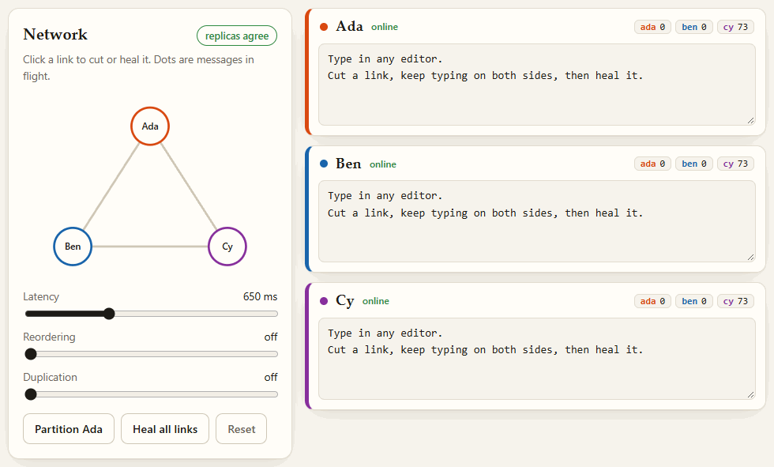
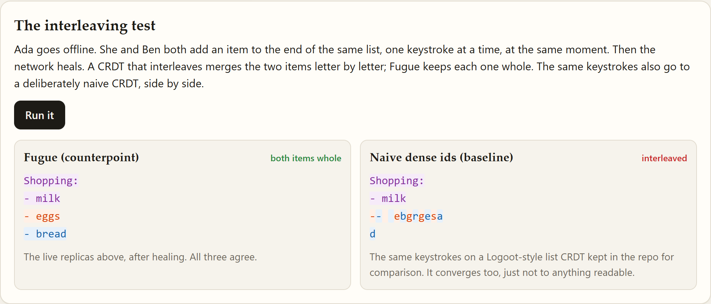

<p align="center">
  
</p>

# counterpoint

counterpoint is a from-scratch TypeScript implementation of the Fugue text CRDT: collaborative plain text where concurrent edits merge without interleaving.

**[Try the playground](https://autumntrace.github.io/counterpoint/)**: three peers, a network you can cut, and the bug Fugue exists to fix, side by side.

[](https://github.com/AutumnTrace/counterpoint/actions/workflows/ci.yml)
[](https://autumntrace.github.io/counterpoint/)

[](LICENSE)

Local-first apps keep a full copy of each document on every device and
merge edits whenever devices meet. For text, that merging is done by a
sequence CRDT like this one. This repo is that core written out in full: the
tree, the index structure, causal delivery, delta sync, a binary format,
property tests that try to break all of it, and a playground to watch it
work.

## The interleaving problem

Ada and Ben both add an item to the end of a shopping list while they are
out of touch. Merged by a CRDT that gives each character a dense position
and breaks ties by replica, their keystrokes get shuffled together. Merged
by Fugue, each line stays whole:

<p align="center">
  
</p>

That is the playground's scenario button: the same keystrokes go to the live
Fugue replicas and to a deliberately naive Logoot-style CRDT kept in
[`src/baseline`](packages/counterpoint/src/baseline/naive.ts). The left one
is the actual result, character for character, coloured by who typed it.
The right one is figure 1 of the Fugue paper, reproduced.

## Using it

```ts
import { TextDoc } from '@autumntrace/counterpoint';

const ada = new TextDoc({ replicaId: 'ada' });
const ben = new TextDoc({ replicaId: 'ben' });

// Local edits apply immediately and return an op to send to everyone else.
ben.apply(ada.insert(0, 'Shopping:\n'));

// Both add an item at the same spot while out of touch...
const fromAda = ada.insert(10, 'eggs\n');
const fromBen = ben.insert(10, 'bread\n');

// ...and exchange ops whenever they can, in any order.
ada.apply(fromBen);
ben.apply(fromAda);

ada.toString(); // 'Shopping:\neggs\nbread\n', same on ben
```

Ops can arrive late, early or twice. After a partition, each side sends its
version vector and gets back exactly what it lacks:

```ts
ben.applyUpdate(ada.encodeChangesSince(ben.version())); // Uint8Array in, Uint8Array out
ada.applyUpdate(ben.encodeChangesSince(ada.version()));

const cy = TextDoc.load(ada.save()); // a third replica, from a snapshot
const first = ada.insert(0, '# ');
const second = ada.insert(2, 'List');

cy.apply(second); // 'buffered': it hangs off a character cy has not seen yet
cy.apply(first);  // 'applied', and releases `second`
cy.apply(first);  // 'duplicate'
```

Carets and selections survive remote edits through anchors, and every
change is reported with indexes you can apply to an editor:

```ts
const caret = ben.anchor(10); // sticks to the character before index 10
ben.onChange(({ origin, changes }) => {
  // 'remote', [{ kind: 'insert', index: 0, text: '# ' }]
});
ben.apply(first);
ben.resolve(caret); // 12
```

`save()` writes the whole document (tombstones and all) as one
`Uint8Array`; `TextDoc.load(bytes)` gives a new replica with a fresh id, or
pass `{ replicaId }` to resume your own session where its counter left off.

These samples run as a test ([`readme.test.ts`](packages/counterpoint/test/readme.test.ts)).
The package is not on npm; it lives in
[`packages/counterpoint`](packages/counterpoint) with zero runtime
dependencies and builds to ESM plus type declarations with `npm run build`.

## What's guaranteed, and what isn't

Checked by tests on every push:

- **Convergence.** Replicas that have applied the same ops have identical
  text, identical internal order (tombstones included), identical version
  vectors and byte-identical snapshots. The property tests run 2 to 4
  replicas over a network that reorders, duplicates and drops messages on
  cut links, then heal and compare.
- **The paper's algorithm, exactly.** A differential property test drives
  `TextDoc` and a line-by-line transcription of the paper's Algorithm 1
  with the same random concurrent histories and requires identical ops and
  identical element order after every step.
- **Forward non-interleaving** in the sense of the paper's Definition 1,
  checked directly on random concurrent histories, for both variants.
- **Concurrent typing sessions stay whole**: two or three groups of replicas
  type at the same position while partitioned from each other, forward,
  backward (each character before the last), with backspaces, or with one
  session spread across two replicas. Every merge is one session's text
  followed by another's. The same property fails for the naive baseline;
  fast-check shrinks that failure to `"aa"` and `"A"` merging into `"aAa"`.
- **FugueMax vs Fugue.** FugueMax (the default) is the variant the paper
  proves *maximally* non-interleaving. Plain Fugue is available as
  `variant: 'fugue'`; the two differ only in cases like the paper's figure 7,
  which is a test: FugueMax gives `AXYBC`, Fugue `AYXBC`.

Not guaranteed, or not done:

- **Some interleaving is unavoidable.** If the history forces it, it
  happens: in the paper's figure 6, `X` is typed between `A` and `C` by a
  replica that has not seen `B`, and every algorithm must end up with
  `AXBC`. Tested too.
- **Plain text only.** No formatting, no undo, no move.
- **Tombstones are forever.** Deleted characters keep their place in the
  tree *and their text*, in memory and in snapshots. In the `seph-blog1`
  trace, deleted text is 155 kB of the 375 kB snapshot.
- **Memory.** One JavaScript object per character ever typed: about 415
  bytes per character in Node for the `automerge-paper` trace. Fine for
  documents, wasteful for books (see the roadmap).
- **Trusted peers.** Nothing is authenticated. A peer can forge ops under
  another replica's id, and two live sessions sharing a replica id will
  corrupt each other. Random ids are the default for that reason.
- **Delivery is up to you.** The library buffers, deduplicates and computes
  deltas; it does not open sockets. If a message is lost and nobody runs a
  sync, replicas stay apart.
- **UTF-16 code units.** Indexes match JavaScript strings and the DOM. An
  editor that lets the caret land inside a surrogate pair could split an
  emoji.

## How it works

Every character is a node in a tree with left and right children; the
document is the tree's in-order traversal. A new character becomes the right
child of the character before it, or, if that one already has right
children, the left child of the character after it. Concurrent typing at one
spot therefore produces sibling subtrees, and a traversal finishes one
subtree before starting the next: no interleaving. FugueMax adds one rule
for ordering right-side siblings.

The literal algorithm walks the tree for every index lookup.
`TextDoc` keeps the tree only to decide where a character goes and stores
the resulting order in a B+tree whose nodes count total and visible
elements, so index lookups, inserts and deletes are O(log n). A remote
insert is placed by a short walk in the Fugue tree (after its parent, after
its previous sibling's subtree, or before its next sibling's) and never by a
traversal.

[**docs/how-fugue-works.md**](docs/how-fugue-works.md) has the diagrams: the
tree, the two insertion cases, why sessions don't interleave, Fugue vs
FugueMax, the order tree, and the sync protocol.

## Sync model

- **Ids and versions.** A character's id is `(replica, counter)`. Deletes
  take a counter too, so a replica's counter numbers everything it has done.
  Ops from one replica are applied in counter order, so a version vector
  like `{ ada: 12, ben: 7 }` says exactly which ops a replica has.
- **Dependencies, not full causal order.** An op waits until its
  predecessor, parent and right origin (or delete targets) are present, in a
  heap keyed by the counter it needs. That is weaker than causal broadcast
  and exactly what Fugue needs. A 20,000-op backlog delivered in reverse
  order drains without quadratic work (tested).
- **Idempotent.** Ops already covered by the version vector are dropped. An
  insert run that partly overlaps what is already here is trimmed to its new
  tail.
- **Delta sync.** `changesSince(version)` regenerates the missing ops from
  the element log itself, merging consecutive characters back into runs.
- **Binary encoding.** LEB128 varints throughout, counters stored as deltas,
  replica names in a per-message table, runs of backspaces folded into one
  record. A single keystroke is about 24 bytes on the wire. Snapshots are
  the full delta with a different header byte, and loading one goes through
  the normal integration path.

## Benchmarks

Real editing traces from Joseph Gentle's
[editing-traces](https://github.com/josephg/editing-traces) (CC BY 4.0):
`automerge-paper` is every keystroke of writing a 17-page LaTeX paper,
`seph-blog1` a blog post. They are downloaded by the benchmark script, not
committed. Every replay is checked against the trace's final text.

AMD Ryzen 7 9800X3D, 32 GB, Windows 11, Node 24.21.0. Medians of 9 runs
after 3 warm-up runs; `npm run bench` reproduces them.

| | automerge-paper | seph-blog1 |
|---|--:|--:|
| Edits in the trace | 259,778 | 137,993 |
| Characters inserted / deleted | 182,315 / 77,463 | 212,489 / 155,720 |
| Final length | 104,852 | 56,769 |
| Replay locally (index-based edits) | 96.9 ms, 2.68 M edits/s | 58.0 ms, 2.38 M edits/s |
| Apply the resulting ops on another replica | 48.2 ms, 5.38 M ops/s | 35.5 ms, 3.97 M ops/s |
| Heap after the replay | 72.2 MB, 415 B per char | 55.6 MB, 274 B per char |
| Average message, one op per message | 24.0 B | 24.3 B |
| Snapshot (equals a full delta sync) | 280.3 kB | 375.0 kB |
| Save / load | 17.4 ms / 34.9 ms | 13.5 ms / 24.8 ms |

Why the index structure matters: the paper's algorithm transcribed directly
(`SimpleFugue`, a tree walk per operation) against `TextDoc`, on the first
*n* edits of `automerge-paper`:

| edits | SimpleFugue | TextDoc |
|--:|--:|--:|
| 2,500 | 103 ms | 3.8 ms |
| 5,000 | 388 ms | 5.9 ms |
| 10,000 | 1,337 ms | 13.2 ms |
| 20,000 | 4,939 ms | 10.8 ms |
| 40,000 | 18,653 ms | 32.8 ms |

(`TextDoc`'s small numbers are within JIT and GC noise of each other; the
full trace above is the reliable figure.)

Concurrency: two replicas each type *n* characters at the same spot while
partitioned, then exchange everything. Placing the second run means walking
the first run's chain once.

| characters per side | merge, both directions |
|--:|--:|
| 10,000 | 6.5 ms |
| 50,000 | 22.1 ms |
| 100,000 | 47.2 ms |

For context, the paper reports 2.4 MB of memory and a 168 kB save for its
optimized Fugue on `automerge-paper` (different machine and method, so only
roughly comparable). The gap in memory is the price of one object per
character; storing runs instead is the first roadmap item.

## Playground guide

[autumntrace.github.io/counterpoint](https://autumntrace.github.io/counterpoint/)
runs entirely in the tab. Each editor is a full replica; the network between
them is simulated, but every message is a real encoded update, version
vector or catch-up.

- **Cut and heal links** by clicking them. *Partition Ada* cuts both of hers.
  Anything in flight on a cut link is lost; healing starts the version
  vector handshake, and you can watch the catch-up messages cross.
- **Latency** delays every message. **Reordering** adds a random extra delay
  per message, so later keystrokes overtake earlier ones: watch the
  "buffered" counter on the receiving peer. **Duplication** sends some
  messages twice; the log shows them being ignored.
- **Cut only one link** (say Ada–Cy) and edits still arrive, relayed by Ben.
- **The message log** shows each delivery with its size and what the
  receiver did: applied, buffered, ignored as a duplicate, or lost.
- **The Fugue tree** draws a replica's tree in document order, so reading
  it left to right spells the text. Runs typed in one go are boxes; deleted
  characters are faded. Try typing a word backwards (move the caret left
  after each letter) to see a chain of left children.
- **Run it** in *The interleaving test* replays the shopping-list scenario
  through Fugue and the baseline.

## Roadmap and known gaps

Written as the issues I would open next:

- **Store runs instead of single characters.** One element object per
  character costs about 415 bytes each in Node. Runs (split on demand, as
  Yjs and the paper's optimized Fugue do) should cut that by an order of
  magnitude.
- **Drop deleted text from snapshots and memory.** Keep tombstone ids and
  tree positions, discard their content; needs a tombstone form of insert
  ops for delta sync.
- **Replay the concurrent editing traces.** `friendsforever` and
  `clownschool` record real two-person sessions with their causal graph;
  replaying them would benchmark the concurrent path on real data.
- **Show remote carets.** Anchors already survive remote edits; send them
  as ephemeral presence and draw them in the playground.
- **A real transport for the playground.** A WebRTC or WebSocket adapter so
  two browser tabs can edit together using the same sync messages.
- **Rich text.** Formatting spans anchored to element ids, in the style of
  Peritext.
- **Compact the delete log.** Each retained delete costs about 200 bytes in
  memory; consecutive backspaces could be stored as one range, as the
  encoding already does.
- **Publish to npm** as `@autumntrace/counterpoint` once the API settles.

## Development

```sh
npm install
npm test            # unit and property tests (Vitest + fast-check), a few seconds
npm run typecheck   # tsc --noEmit across the library, playground and e2e tests
npm run dev         # playground at http://localhost:5173/counterpoint/
npm run build       # library to packages/counterpoint/dist, playground to apps/playground/dist
npm run e2e         # Playwright against the built playground, using installed Chrome
npm run bench       # downloads the two traces, then replays them
npm run media       # rebuilds the README GIF and screenshot
```

The [devlog](docs/devlog.md) has notes on what went wrong along the way: the
property tests that were secretly tiny, the snapshot format that lost to the
op log, and a few others.

## Credits and references

- Matthew Weidner and Martin Kleppmann,
  [*The Art of the Fugue: Minimizing Interleaving in Collaborative Text Editing*](https://arxiv.org/abs/2305.00583).
  The algorithm, the FugueMax variant, the non-interleaving definitions and
  the examples the tests are built on. Their implementation and benchmarks:
  [mweidner037/fugue](https://github.com/mweidner037/fugue). This code was
  written from the paper, not ported.
- Martin Kleppmann, Victor B. F. Gomes, Dominic P. Mulligan and Alastair R.
  Beresford,
  [*Interleaving Anomalies in Collaborative Text Editors*](https://martin.kleppmann.com/papers/interleaving-papoc19.pdf),
  PaPoC 2019. The first write-up of the problem.
- Seph Gentle's [reference-crdts](https://github.com/josephg/reference-crdts)
  (YjsMod, where FugueMax's right-origin rule comes from) and
  [editing-traces](https://github.com/josephg/editing-traces). The
  `automerge-paper` trace originally comes from Martin Kleppmann's
  [automerge-perf](https://github.com/automerge/automerge-perf); both traces
  are CC BY 4.0.
- Stéphane Weiss, Pascal Urso and Pascal Molli,
  [*Logoot*](https://doi.org/10.1109/ICDCS.2009.75), ICDCS 2009, the model
  for the naive baseline.
- For the bigger picture, the production CRDT libraries this is a toy
  sibling of: [Yjs](https://github.com/yjs/yjs),
  [Automerge](https://github.com/automerge/automerge) and
  [Loro](https://github.com/loro-dev/loro); and Ink & Switch's essay
  [*Local-first software*](https://www.inkandswitch.com/essay/local-first/).

## License

[MIT](LICENSE) © 2026 Mina Rotari
