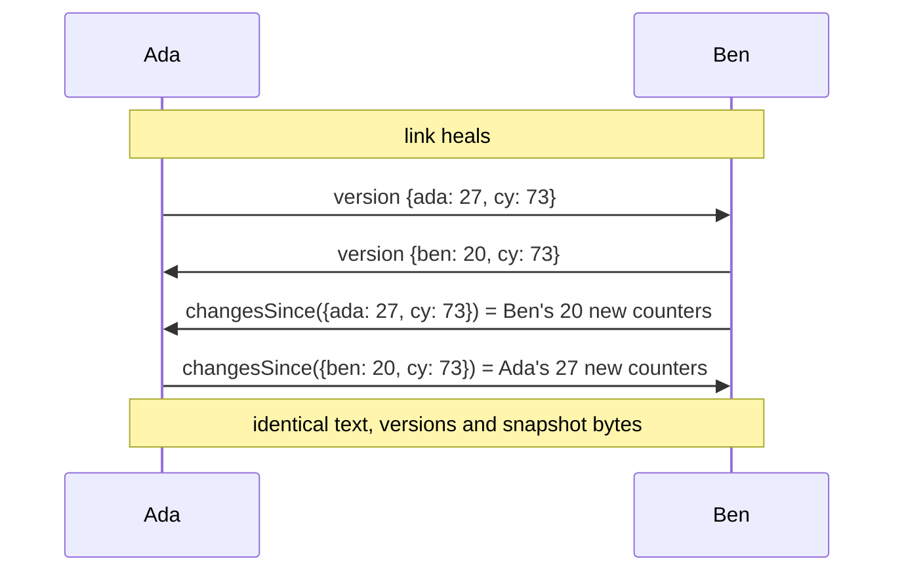

# How Fugue works (and how counterpoint implements it)

This is the long version of the "How it works" section in the README. The
algorithm is from Matthew Weidner and Martin Kleppmann,
[*The Art of the Fugue: Minimizing Interleaving in Collaborative Text Editing*](https://arxiv.org/abs/2305.00583).
Everything below about the algorithm is their work; the parts about the
order tree, runs and sync are how this repo turns it into a library.

## The problem

Two people edit the same document while out of touch with each other. The
list says `milk`. Ada adds `eggs` underneath, Ben adds `bread` in the same
place. Both are fine on their own; the question is what the merge looks like.

Many collaborative-editing algorithms give every character a position in a
dense, ordered space and sort by it. Ada's first character and Ben's first
character get the same position (they were inserted between the same two
neighbours), so a tie-break on replica id decides who goes first. Then the
same happens for the second characters, and the third:

```
Ada:   e  g  g  s
Ben:   b  r  e  a  d
       ↓  ↓  ↓  ↓
merge: e b g r g e s a d
```

That is figure 1 of the paper, and it is exactly what the naive baseline in
[`src/baseline/naive.ts`](../packages/counterpoint/src/baseline/naive.ts)
produces (`milk\nebgrgesa\nd\n`; there is a test for it). Fugue's answer is
to stop treating characters as independent points and remember what each
character was typed *after*.

## The tree

Every character is a node in a tree. A node can have **left children** and
**right children**, any number of each. The document is the tree's in-order
traversal: for each node, first its left children (each with its whole
subtree), then the node itself, then its right children (each with its whole
subtree). Deleted characters stay in the tree as tombstones; the traversal
just doesn't print them.

Here is one possible tree for `abcdef` (figure 2 in the paper):

```
            root
              │R
              c
      ┌───────┼────────┐
     L│      L│       R│
      a       b        e
                   ┌───┴───┐
                  L│      R│
                   d       f
```

Traversal: `c`'s left children `a`, `b`; then `c`; then `c`'s right child
`e`, which itself expands to `d e f`. Result: `abcdef`.

Siblings on the same side are ordered by a fixed rule (below). The tree is
not balanced and never needs to be.

## Inserting

To insert between the visible characters at index `i-1` and `i`, take the
**left origin** (the character at `i-1`, or the root) and the **right
origin** (whatever comes next in the traversal, *tombstones included*, or
the end of the document). Then:

1. If the left origin has no right children, the new character becomes its
   right child.
2. Otherwise it becomes a left child of the right origin.

```
(1) insert g between a and b         (2) insert h between a and g

        c                                    c
   ┌────┴────┐                          ┌────┴────┐
   a         b                          a         b
   └─R─ g                               └─R─ g
                                             └─L─ h
```

In case 2 the right origin is always the first node of the left origin's
right subtree, and that node never has left children yet, so a replica only
ever creates a node where it has no same-side sibling. Siblings appear only
when *different* replicas insert at the same place concurrently.

Typing a word left to right builds a chain: every new character is the right
child of the previous one. Typing right to left (each character inserted
before the last) builds a chain of left children. Either way, the word ends
up as one subtree.

## Why concurrent typing doesn't interleave

Back to `eggs` and `bread`, both typed after the newline `↵` that ends
`milk`:

```
    ↵
    ├─R─ e ─R─ g ─R─ g ─R─ s            Ada
    └─R─ b ─R─ r ─R─ e ─R─ a ─R─ d      Ben
```

`e` and `b` are right-side siblings. The traversal visits all of `e`'s
subtree before it starts on `b`'s, so the result is `eggs` then `bread` (or
the other way round, depending on the sibling rule) and never a mix. The same
argument covers typing backwards, typing with backspaces, and one person's
session spread over two devices: each session's characters sit in their own
subtree. The paper proves this formally; this repo checks it with property
tests on random histories (see `test/non-interleaving.test.ts`).

What no algorithm can prevent is the interleaving that the history itself
forces. Figure 6 of the paper: three replicas insert `A`, `B`, `C`
concurrently into an empty document (they end up as `ABC`). Replica 1, which
has only seen `A` and `C`, inserts `X` between them. Every replica must
eventually show `AXBC`, so `X` ends up next to `A` but not next to `C`,
whatever the algorithm. There is a test that checks Fugue produces exactly
that.

## Fugue and FugueMax

The two variants differ only in how **right-side siblings** are ordered.

- **Fugue** orders all same-side siblings by id (replica, then counter).
- **FugueMax** orders right-side siblings by their right origins, in
  *reverse* document order (a sibling whose right origin is the end of the
  document comes first), and only uses ids to break ties. Left-side siblings
  are ordered by id as in Fugue.

FugueMax is the version the paper proves *maximally* non-interleaving: it
avoids every interleaving that can be avoided at all. Figure 7 of the paper
is where they differ: `A`, `B`, `C` are inserted concurrently, replica `c`
then inserts `X` between `A` and `C`, and replica `b` inserts `Y` between `A`
and `B`. `X` and `Y` are both right children of `A`, with right origins `C`
and `B`. FugueMax puts `X` first (its right origin is later), giving `AXYBC`,
which keeps `Y` next to `B`. Fugue sorts them by id and gives `AYXBC`. The
tests run both.

counterpoint defaults to FugueMax (`variant: 'fugue-max'`). Every insert op
carries its right origin either way, so the variant only changes the sibling
comparison, but all replicas of one document must agree on it; encoded
messages and snapshots record it and are rejected on a mismatch.

## From the tree to indexes: the order tree

Taken literally, the algorithm walks the tree to answer every question
("which character is at index 500?", "where did this remote character
land?"). [`src/reference/simple-fugue.ts`](../packages/counterpoint/src/reference/simple-fugue.ts)
does exactly that. It is under 300 lines, maps onto the paper line by line,
and needs about 19 seconds for the first 40,000 keystrokes of the
`automerge-paper` trace. It is kept as the test oracle.

[`TextDoc`](../packages/counterpoint/src/text-doc.ts) keeps the Fugue tree
only for deciding *where* a new character goes, and stores the result
separately: every element, tombstones included, lives in an
[order tree](../packages/counterpoint/src/order-tree.ts), a B+tree in
document order whose leaves are small arrays of elements and whose nodes
cache two counts, all elements and visible elements.

```
                      branch  size 9  visible 7
                  ┌──────────────┴───────────────┐
   leaf  size 4  visible 3           leaf  size 5  visible 4
   [ S  h  o̶  p ]                   [ p  i  n̶  g  ! ]
```

- **index → element**: walk down, skipping children whose `visible` count is
  too small, then scan one leaf. O(log n) plus up to 128 items.
- **element → index**: every element points at its leaf; walk up, adding the
  counts of the siblings to the left. Same cost.
- **delete**: flip the flag, decrement `visible` on the path to the root.
- **insert**: splice into a leaf, bump counts upwards, split leaves over 128
  items and branches over 32 children.

Placing a character never needs a traversal, because the Fugue tree pins it
next to something already in the order tree:

| new node `N` | goes right after | or right before |
|---|---|---|
| right child, first among its siblings | its parent | |
| right child after sibling `S` | the last node of `S`'s subtree | |
| left child, last among its siblings | | its parent |
| left child before sibling `S` | | the first node of `S`'s subtree |

"Last node of a subtree" means following last right children down; "first
node" means following first left children. Local inserts never have
siblings, so they always hit the first or third row and cost O(log n). A
remote insert that lands next to a concurrent sibling may walk down that
sibling's chain once; the benchmark's worst case (two 100,000-character runs
typed at the same spot) merges in under 50 ms.

A differential property test feeds the same random concurrent histories to
`TextDoc` and to `SimpleFugue` and requires identical ops and identical
element order (tombstones included) after every step, with histories long
enough to force leaf and branch splits.

## Runs

A user typing `hello` produces five tree nodes, each the right child of the
previous one, all with the same right origin. counterpoint sends that as one
insert op (first character's id, parent, side, right origin, text) and the
receiver rebuilds the chain. It is purely a compression of five
single-character inserts: the tree is identical. Elements are still stored
one object per character in memory, which is the main reason memory use is
what it is (see the README).

## Ids, versions and sync

Each character's id is `(replica, counter)`. Delete ops take a counter value
too, so a replica's counter numbers everything it has ever done. Ops from one
replica are applied strictly in counter order, which means "I have applied
counters `0 .. n-1` of replica `r`" is the whole story, and a version vector
(`{ ada: 12, ben: 7 }`) describes a replica's state exactly.

An op can be applied once its own predecessor, its parent, its right origin
(or for a delete, its targets) are present. Anything else waits in a buffer,
in a heap keyed by the counter it needs, and is released when that counter
arrives. An op that is already covered by the version vector is dropped,
and a resent insert run that only partly overlaps is trimmed to its unseen
tail (its first new character's parent is simply the previous character of
the same run).

That is weaker than full causal broadcast, and it is all Fugue needs: two
ops whose dependencies are present commute, and the relative order of two
existing elements never changes, which is what FugueMax's right-origin
comparison relies on.

Reconnecting is one round trip each way:



`changesSince` regenerates the missing ops from the element log itself
(consecutive characters merge back into runs), so nothing but the document
is stored. Snapshots are the same thing for an empty version vector, in the
same binary format; loading one replays it through the normal integration
path.
